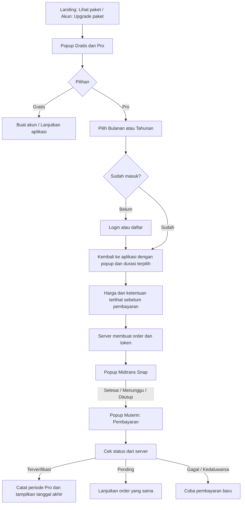

# Sistem paket dan pembayaran Muterin

## Keputusan produk

Langganan merupakan pengaturan akun, sehingga tidak menjadi fitur navigasi utama atau halaman dashboard tersendiri. Satu popup melayani perbandingan paket, pemilihan durasi, status paket, dan transaksi. Popup dibuka lewat menu akun atau CTA harga di landing page. Halaman aplikasi tetap menjadi konteks di belakang popup.

Ada dua tier: **Gratis** dan **Pro**. Bulanan dan tahunan merupakan durasi Pro dengan fitur sama, bukan tiga tier berbeda. Tidak ada paket Max/Team karena produk belum menawarkan kebutuhan atau kemampuan berbeda untuk paket tersebut.

Referensi Claude dipakai untuk hierarki popup upgrade, kartu paket, toggle durasi, header dengan tombol tutup dan konten yang bisa di-scroll. Warna hijau Muterin, font Manrope dan ikon motor/rute dipertahankan. Ikon menjelaskan catatan motor dan perjalanan, bukan ornamen paket abstrak.

## Riset dan batas penerapan

Menurut [panduan upgrade Claude](https://support.claude.com/en/articles/8325609-how-do-i-sign-up-for-the-pro-plan), pengguna memilih paket dan periode pembayaran; layanan tersebut memperpanjang otomatis. [Penggantian periode Claude](https://support.claude.com/en/articles/10185996-how-to-change-your-pro-plan-from-monthly-to-annual-billing) juga mengatur kredit sisa waktu. Pola UI dapat digunakan, tetapi kebijakan tagihan itu tidak otomatis berlaku pada Muterin.

Midtrans memisahkan [Snap checkout](https://docs.midtrans.com/docs/snap-snap-integration-guide) dari [Subscription API](https://docs.midtrans.com/reference/create-subscription). Recurring produksi membutuhkan kanal pembayaran yang mendukung dan aktivasi merchant; lihat [card subscription](https://docs.midtrans.com/reference/two-clicks). Implementasi Muterin saat ini memakai Snap untuk pembayaran sekali per periode. Karena itu UI tidak menawarkan auto-debit, pembatalan recurring atau prorata yang belum tersedia.

## Alur pengguna

Mengklik CTA landing hanya membuka popup. Pengguna belum diminta login saat membandingkan harga. Login dibutuhkan ketika memilih Pro. Redirect autentikasi mempertahankan durasi lewat endpoint checkout lama, lalu membuka popup di dashboard; tidak langsung membuat order atau menagih pengguna.

Popup Muterin ditutup sebelum Snap dibuka supaya hanya ada satu dialog yang menguasai fokus. Saat Snap selesai atau ditutup, popup Muterin dibuka kembali pada bagian pembayaran. Callback browser tidak menentukan status lunas: backend meminta status Midtrans. Finish redirect dari provider juga menuju aplikasi dengan popup pembayaran terbuka.

## Struktur UI dan desain sistem

| Bagian | Isi dan aturan |
|---|---|
| Header | Judul Paket Muterin, tombol X 44 px dengan SVG 26 px |
| Pilihan paket | Dua kartu Gratis/Pro, manfaat singkat, harga, CTA, rancangan fitur |
| Durasi Pro | Toggle Bulanan/Tahunan dengan `aria-pressed`; total tahunan ditampilkan sebagai Rp190.000 untuk 12 bulan |
| Pembayaran | Status paket, tanggal akhir, daftar order dengan status, nominal, tanggal, periode dan aksi |
| Daftar order | Pagination 10 transaksi; tombol sebelum/berikut; hanya order pemilik akun |
| Loading | Skeleton transaksi, teks pemeriksaan, spinner saat checkout dibuat, pencegahan klik ganda |
| Empty | Belum ada transaksi, arahan kembali ke pilihan paket |
| Error | Pesan pada konteks popup dan tombol muat ulang; tidak menyatakan pengguna Gratis jika pengambilan status gagal |
| Keyboard | Fokus terperangkap dalam dialog, Escape menutup, fokus kembali ke pemicu; fokus tampak jelas |
| Mobile | Kartu 2 kolom berdampingan (kanan-kiri), header tetap di atas area konten, scroll di dalam popup, target sentuh optimal |

Tokens komponen berada di `resources/css/subscription.css`: latar #18201c, kartu #232d27, teks #f5f6f2, teks sekunder #b9c4bc, aksen #85dfbd. Latar gelap mengikuti referensi yang diminta; aksen hijau memusatkan perhatian pada Pro. Radius dialog dan kartu 4 px, tombol 3 px; jarak antar kartu 24 px, padding kartu 26 px. Tidak menambah font, library animasi, atau dependency UI baru.

## Status dan aturan sistem

| Status order | Arti | Tindakan |
|---|---|---|
| pending | Order tercatat, belum terverifikasi lunas | Cek status; lanjutkan token yang sama |
| paid | Settlement/capture diterima Midtrans | Tampilkan periode, tambahkan masa berikutnya tepat sekali |
| failed | Pembuatan checkout atau pembayaran gagal | Pilih paket untuk mencoba lagi; periksa status jika diperlukan |
| expired | Batas waktu pembayaran habis | Checkout baru |
| cancelled | Transaksi dibatalkan provider | Checkout baru |
| refunded | Full refund telah dikonfirmasi | Periode order ini tidak dianggap aktif |

Status paket berbeda dari status order. Order paid belum tentu menjadi paket aktif hari ini: periodenya mungkin dijadwalkan sesudah paket lain. Paket aktif diturunkan dari order paid dengan `starts_at <= sekarang < ends_at`. Ketika periode berakhir, status aktif hilang tanpa harus menunggu cron. Perpanjangan manual menambahkan periode setelah masa sebelumnya berakhir. Webhook duplikat tidak menambah periode lagi.

Nominal berasal dari konfigurasi server. Signature, nominal, lingkungan, dan status provider diperiksa backend. Token checkout hanya dikirim lewat endpoint POST pemilik; API ringkasan tidak menyertakan token atau Server Key. Riwayat Sandbox dan Production terpisah. Data transaksi di-render memakai `textContent`, bukan HTML dari provider/pengguna.

## Trial, pembatasan fitur, dan recurring

**Saat ini:** Snap mendukung endpoint Sandbox dan Production, pencatatan masa paket, perpanjangan manual dan riwayat pembayaran. Konfigurasi lokal dipilih Production sesuai permintaan pemilik; Kunci disimpan hanya di environment lokal/deployment dan tidak disertakan dalam repository. Validitas merchant dan transaksi sungguhan tetap perlu diverifikasi melalui Midtrans. Pengujian otomatis mensimulasikan respons API kedua environment, bukan membuat transaksi sungguhan. Trial dan pembatasan fitur belum diaktifkan. Tabel manfaat diberi label rancangan fitur supaya tidak mengklaim akses yang belum dibatasi sistem. Ketika kunci Production valid diisi dan merchant aktif, checkout menggunakan tagihan uang sungguhan.

**Tahap trial selanjutnya:** buat status trial satu kali per akun dengan timestamp awal/akhir; mulai saat pengguna menekan CTA trial yang eksplisit, bukan setiap login. Tentukan dahulu fitur Pro yang dibatasi. Tampilkan sisa hari dan harga setelah trial. Tanpa otorisasi recurring, akhir trial tidak menghasilkan tagihan otomatis; arahkan pengguna ke checkout manual dan pertahankan data historisnya.

**Tahap recurring selanjutnya:** pilih kanal yang mendukung, aktivasi merchant, persetujuan auto-debit yang jelas, penyimpanan token provider tanpa data kartu mentah, webhook recurring, kegagalan penagihan dan retry, pembatalan perpanjangan dengan akses sampai periode lunas berakhir. Baru sesudah itu UI dapat menawarkan "Batalkan perpanjangan otomatis". Prorata upgrade/downgrade membutuhkan aturan tersendiri; tidak disamakan dengan pembelian masa tambahan.

**Operasional berikutnya:** rekonsiliasi order pending terjadwal, notifikasi akhir periode, dukungan refund, audit trail pembayaran, idempotensi pembuatan order lintas tab, serta pengujian merchant Sandbox end-to-end. Ini bukan kemampuan yang diklaim selesai pada perubahan UI ini.

## Implementasi dan kompatibilitas

- `resources/views/partials/subscription-dialog.blade.php`: satu popup pada layout aplikasi dan marketing.
- `public/js/subscription.js`: toggle durasi, pembukaan dialog, ringkasan AJAX, Snap dan pengembalian status.
- `resources/css/subscription.css`: token, ukuran, grid, focus, skeleton dan responsive.
- `GET /langganan/summary`: ringkasan JSON terautentikasi, scoped pemilik dan environment.
- `/langganan`, `/langganan/checkout/{plan}`, `/langganan/pembayaran`: redirect kompatibilitas yang membuka popup; tidak memiliki halaman tersendiri.
- Endpoint pay, resume, refresh dan webhook Midtrans tetap dipakai. Pengujian pembayaran tidak diganti oleh pengujian UI.

Referensi perilaku modal: [WAI-ARIA Modal Dialog Pattern](https://www.w3.org/WAI/ARIA/apg/patterns/dialog-modal/).
